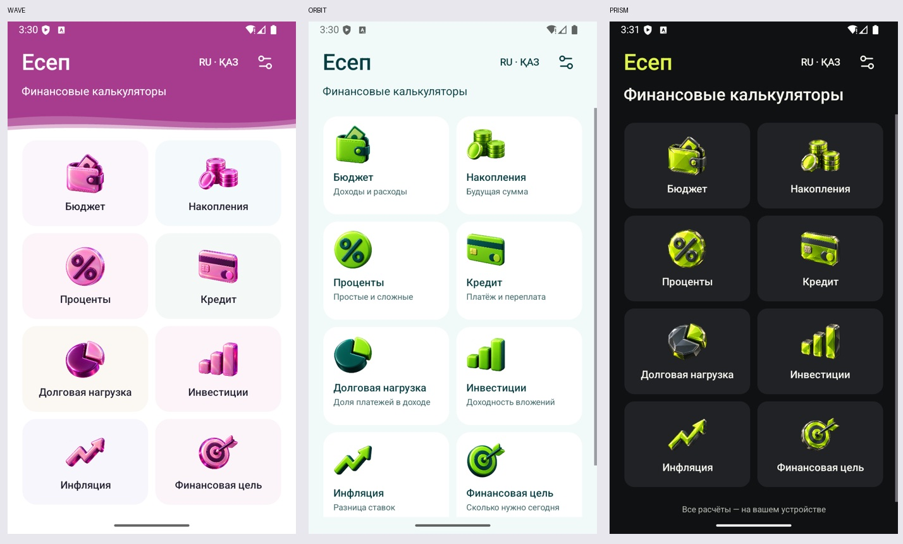

# Есеп

Финансовые калькуляторы для Android на русском и казахском языках. Работают офлайн, без регистрации.

## Установить приложение

**[Скачать Есеп для Android](https://github.com/Suleyman18987/Esep/releases/latest/download/Esep.apk)**

1. Откройте ссылку на Android-телефоне и скачайте `Esep.apk`.
2. Откройте скачанный файл. Если Android попросит, разрешите установку приложений из выбранного браузера или файлового менеджера.
3. Нажмите «Установить», затем «Открыть».

Нужен Android 7.0 или новее. Скачивание само по себе не устанавливает приложение. ZIP с исходниками для обычной установки не нужен. Это Android-приложение: на iPhone APK не устанавливается.

## Қазақша

**[Android үшін Есеп жүктеу](https://github.com/Suleyman18987/Esep/releases/latest/download/Esep.apk)**

`Esep.apk` файлын жүктеп, ашыңыз. Android сұраса, осы браузерден не файл менеджерінен орнатуға рұқсат беріңіз. «Орнату» түймесін басыңыз. Android 7.0 немесе жаңарақ нұсқасы қажет. Интернет пен тіркелгі қажет емес.

## Возможности

- Бюджет и распределение остатка 50/30/20.
- Накопления, простые и сложные проценты.
- Кредит, долговая нагрузка, доходность вложений.
- Упрощённое сравнение ставки с инфляцией и финансовая цель.
- Три интерфейса: Волна, Orbit и Prism. У каждого свой 3D-набор и три цветовых акцента.
- Формулы с обозначениями, разделители тысяч, встроенная или системная клавиатура.



[Все девять сочетаний интерфейса и цвета](docs/images/Esep-2.4-nine-colors.jpg).

## Собрать из исходников

Откройте корневую папку в Android Studio. Используются JDK 17, Android SDK 35 и Gradle Wrapper. Создайте локальный `local.properties` с путём к вашему Android SDK либо выберите SDK в Android Studio.

```shell
./gradlew :app:assembleDebug
```

Windows: `gradlew.bat :app:assembleDebug`. Результат: `app/build/outputs/apk/debug/app-debug.apk`. Первый запуск сборки может загрузить зависимости.

## Условия расчётов

Кредит использует месячную ставку. Регулярные взносы в накоплениях — годовые, в конце года. Доли бюджета считаются от остатка. Сравнение ставки с инфляцией — упрощённая разница в процентных пунктах. Финансовая цель считает разовый вклад сегодня. Условия отмечены в интерфейсе.

## Автор и ресурсы

[Instagram · @solomon_19__](https://www.instagram.com/solomon_19__/) · [TikTok · @suleyman_0805](https://www.tiktok.com/@suleyman_0805)

Линейные служебные иконки: Lucide, ISC. Лицензия — в `licenses/` и ресурсах приложения. 3D-изображения включены в приложение и не требуют загрузки из сети.

## Веб-версия и iPhone

В папке [web](web/README.md) находится PWA с теми же восемью калькуляторами, тремя интерфейсами и RU/KK. Работает без базы данных; после первой загрузки доступна офлайн. [Проверки](web/QA.md).

